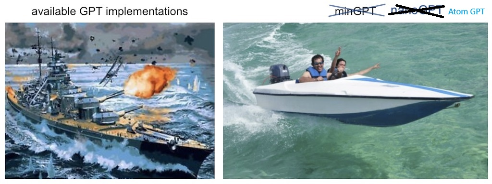
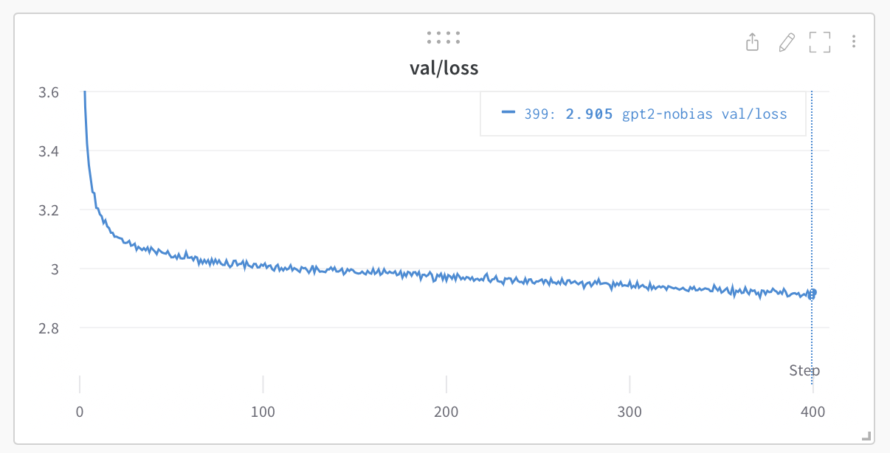

# ATOM-GPT



**A**dvanced **T**ransformer **O**ptimized for **M**usical **GPT** — specialized fine‑tuning of a lightweight GPT architecture on curated metal lyrics with optional enhancement via external LLM (LM Studio). Provides: training pipeline, sampling utilities, Flask API, and React chat/completion UI.

> Start Here (0 Experience Path): 1) Clone repo 2) `pip install -r requirements.txt` 3) `python configure.py` 4) `cd backend/training && python train.py ../config/test_darklyrics.py` (sanity) 5) `python server.py` (API) 6) `cd frontend && npm install && npm start`.

> 📚 **[Documentation Index](DOCUMENTATION.md)** | ⚙️ **[Backend Guide](backend/README.md)** | 🖥️ **[Frontend Guide](frontend/README.md)**



## 📋 Table of Contents
- Documentation & Index
- Project Structure
- Architecture & Visualization
- Install
- Quick Start (Web App)
- Training
- Dataset

## Project Structure
```
├── backend/            # API, training, configs, model, enhancement
├── frontend/           # React (chat + completion UI)
├── assets/             # Images / static assets
├── tests/              # Full test suite
├── ENHANCED_MODEL_SUMMARY.md
├── DOCUMENTATION.md
└── README.md
```
Detailed: see `backend/README.md` + `frontend/README.md`.

## Architecture & Visualization
- Flowcharts & interactive visualizations under `backend/visualization/`.
- Chat + enhancement pipeline described in `backend/training/CHAT_IMPROVEMENTS.md`.

## 📚 Documentation (Key Entry Points)
| Goal | Read |
|------|------|
| Absolute beginner setup | This README (top quick path) |
| Backend API + training | `backend/README.md` |
| Frontend UI usage | `frontend/README.md` |
| Model architecture | `ENHANCED_MODEL_SUMMARY.md` |
| Training improvements | `backend/training/README_UPDATES.md` |
| Chat pipeline | `backend/training/CHAT_IMPROVEMENTS.md` |
| Config reference | `backend/config/ENHANCED_CONFIG_GUIDE.md` |
| Auth system | `AUTHENTICATION_COMPLETE.md` |
| Tests | `tests/README.md` |

## Install
Backend + training dependencies:
```bash
pip install -r requirements.txt
```
Frontend dependencies:
```bash
cd frontend
npm install
```
(Ensure Node.js ≥16, Python ≥3.10 recommended, CUDA-enabled PyTorch if using GPU.)

## Running the Web Application
### Prerequisites
1. Train (or test-train) a checkpoint (see below).
2. Environment variables (`.env` or defaults) — optional.
3. Backend dependencies + Node.js installed.

### Steps
1. Backend API:
```bash
cd backend/api
python server.py
```
2. Frontend:
```bash
cd frontend
npm start
```
3. Visit `http://localhost:3000`.

### Features Recap
- Chat (multi-turn, enhancement flag, controls)
- Completion interface
- Sampling controls: temperature, top_p, repetition penalty, max tokens
- LM Studio enhancement integration (optional)

## Quick Start (Training)
### Sanity (Quick Test)
```bash
cd backend/training
python train.py ../config/test_darklyrics.py
```
### Full DarkLyrics Fine‑Tune
```bash
cd backend/training
python train.py ../config/train_darklyrics.py
```
### Generate Samples
```bash
python sample.py --out_dir ../out-darklyrics --temperature 0.8 --top_p 0.95 --repetition_penalty 1.1
```

## Enhancement (LM Studio)
(Optional) Launch LM Studio, load a model, confirm port (default 1234), set in `.env`:
```
LM_STUDIO_URL=http://localhost:1234
```
Backend will attempt enhancement automatically when `enhance: true` in request.

## Hardware Profiles
| Hardware | Suggested Adjustments |
|----------|-----------------------|
| 8GB GPU | Default config (8L / 512 embd / 512 block) |
| 12GB GPU | Increase batch_size or embd=640 |
| 24GB GPU | 12L / 12H / 768 embd / 768 block |
| CPU Only | 4L / 384 embd / 256 block |

If OOM: lower batch_size → raise gradient_accumulation_steps → reduce block_size → reduce layers.

## Quality Tuning
| Desired | Settings |
|---------|----------|
| Structured verses | temp 0.7, top_p 0.9 |
| More imagery | temp 0.9, top_p 0.95 |
| Reduce loops | repetition_penalty 1.1–1.2 |

## Troubleshooting (Fast Reference)
| Issue | Fix |
|-------|-----|
| API 404 | Confirm `python server.py` in `backend/api` |
| Enhancement ignored | LM Studio not running / URL mismatch |
| Slow generation | Check CUDA availability, reduce max tokens |
| Repetition | Increase temperature slightly + add repetition penalty |
| Import errors in tests | Run from project root or adjust PYTHONPATH |

## Roadmap (Abbrev.)
- AMP mixed precision toggle
- LoRA / PEFT adapter support
- Checkpoint manifest (config + hash)
- Automated eval metrics (perplexity, rhyme density)
- Multi-draft reranking pre-enhancement

---
_Last Updated: Aug 2025_
